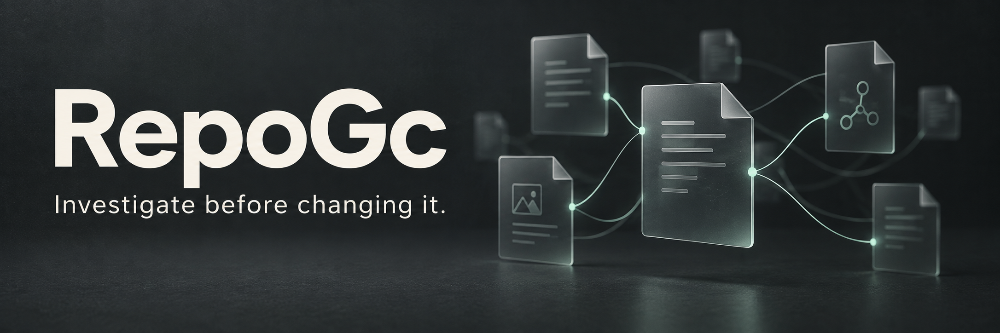

<p align="center">
  <strong>A quieter way to review your repository.</strong><br>
  Find stale information and broken references. Investigate with your AI. You decide.
</p>

<p align="center">
  <a href="https://github.com/cooleryu/RepoGc/actions/workflows/ci.yml"></a>
  <a href="LICENSE"></a>
  
  
</p>

<p align="center">
  <a href="#quick-start">Quick start</a> ·
  <a href="docs/first-review.md">Walkthrough</a> ·
  <a href="docs/PHASE0_STATUS.zh-CN.md">中文说明</a> ·
  <a href="https://github.com/cooleryu/RepoGc/issues">Give feedback</a>
</p>

---

## Less guessing. More evidence.

Repositories accumulate old plans, conflicting instructions and disconnected
documents. RepoGC surfaces clues worth investigating—not a deletion list.

**帮你找出仓库里值得整理的地方，查清依据，再由你和你的 AI 决定怎么处理。**
检查当前状态，不预设新增模块，也不把“暂未使用”当作“应该删除”。

| Observe | Investigate | Decide |
| :--- | :--- | :--- |
| RepoGC collects references, source locations and coverage limits. | You or your AI check context, actual impact and reasons to keep things. | You choose what to fix, clarify, retain or defer. |

> **Experimental, read-only review.** The CLI performs deterministic text checks;
> it does not run an AI model or delete files. Complete AI handoff and measurable
> maintainer time savings are still being evaluated.

## Quick start

Python 3.11+ is required. There are no third-party runtime dependencies.
Install from source in an isolated environment (macOS / Linux):

```sh
git clone https://github.com/cooleryu/RepoGc.git
cd RepoGc
python3 -m venv .venv
. .venv/bin/activate
python -m pip install .
repogc review examples/first-review
```

The [walkthrough](docs/first-review.md) includes two cases:

- A setup link points to a missing file; reading the replacement guide supports
  proposing a link correction.
- A design document has no observed incoming link, but the roadmap says to keep
  it for staged work. The scan does **not** justify deletion.

The example is synthetic and shipped with the project. These interpretations
come from reading its context, not from the CLI automatically inferring intent.
The walkthrough shows how to inspect all observations and hand them to your AI.

For your own repository:

```sh
repogc review /path/to/repository
```

Check [configuration and coverage](docs/configuration.md): a repository-level
review is not exhaustive language, runtime or external-consumer analysis.

## What you get

- Mechanical observations with source locations and explicit unknowns.
- A short selection of review cards, not a list of things to delete.
- Optional complete local evidence snapshots, including unshown findings:

```sh
repogc review /path/to/repository --bundle /tmp/new-repogc-evidence
repogc verify-bundle /tmp/new-repogc-evidence
```

The bundle directory must be new and outside the target. Bundles can contain
sensitive source text; do not upload them without review and permission.
Verification establishes internal consistency, not truth, authorship or current
repository freshness. See the [bundle contract](docs/evidence-bundle.md).

`RELIABLE` means the configured scan and self-checks completed, not that a
candidate is a real problem. Fewer cards do not prove less maintenance work.

## Work with your AI

RepoGC needs no separate model account or API key. You can read its output
yourself or ask your existing assistant to investigate evidence, counterevidence
and unknowns using the [investigation template](docs/first-review.md).
Your assistant's permissions, data-sharing policies and costs still apply.

An optional repository-scoped `repogc-review` skill provides bounded context
annotations in compatible hosts. It is not installed globally by `pip install`,
does not perform a complete semantic audit and is not required for the CLI.

## Boundaries

- `review` is read-only with respect to the scanned repository.
- The scanner does not run target builds, tests, hooks or package managers;
  it makes no network or model calls.
- Git reads use defensive settings; this is not an operating-system sandbox.
- Runtime use, external consumers and future plans may remain unknown.
- AI annotations cannot rewrite mechanical findings or grant permission.
- Formal baselines change only through explicit `baseline --update`.
- No cleanup executor is implemented. Do not post upstream issues solely
  because a scanner flagged something.

## Status and feedback

Available: mechanical scanning, evidence graph, bounded review, validated
annotations, local evidence bundles, development tests and evaluation tooling.
Still being developed: complete AI investigation handoff, genuinely small
human decision sets and real maintainer-value studies. This is not a stable
release and is not advertised as an unused-code detector.

Start with [current status](docs/PHASE0_STATUS.zh-CN.md) and the
[engineering and evaluation plan](docs/ENGINEERING_AND_EVALUATION.md).
We welcome false positives, missing context and minimal reproductions through
[GitHub issues](https://github.com/cooleryu/RepoGc/issues).
Do not attach private repository snapshots, credentials or sensitive material.
See [contributing](CONTRIBUTING.md), [security](SECURITY.md) and
[privacy](docs/privacy.md).

The three project-governance documents remain distinct:

- [AGENTS.md](AGENTS.md): entry point and rules for AI collaborators.
- [North star](docs/NORTH_STAR.md): purpose and success criteria.
- [Constitution](docs/CONSTITUTION.md): evidence, authority and handoff boundaries.

Advanced commands: `scan`, `explain`, `diff`, `doctor`, `annotate`, and
`baseline --update`. See the [manual](docs/GC_MANUAL.zh-CN.md),
[architecture](docs/architecture.md), [report schema](docs/report-schema.md),
[findings](docs/findings.md), [annotations](docs/annotations.md),
[audit index](docs/audit-index.md) and [changelog](CHANGELOG.md).

## License

[Apache-2.0](LICENSE). Copyright 2026 RepoGC contributors.
The license covers RepoGC originals, not repositories it scans.
